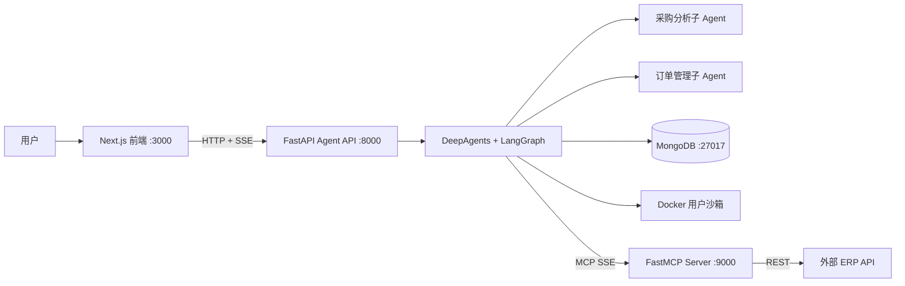

# ERP 智能采购助手：面试项目总览

## 1. 一句话介绍

这是一个面向摩托车零部件采购场景的多智能体系统：用户用自然语言提出查询、分析或业务操作，Agent 通过 MCP 调用 ERP 接口，并用 LangGraph 检查点、人工审批和 Docker 沙箱控制执行风险。

## 2. 项目归属与边界

这是我的个人项目成果。我主导完成了本地环境搭建、代码理解与工程化改造、Agent 与 ERP 联调、人工审批链路修复、真实业务测试以及演示材料整理。

项目使用 DeepAgents、LangGraph、FastAPI、Next.js、MongoDB、FastMCP 等开源框架，并在开源 ERP-Agent 代码基础上持续改造。课程老师提供并授权使用外部 ERP API；本仓库不包含该 Java ERP 后端源码。因此，我负责的是智能 Agent 系统及其集成层，不把外部 ERP 后端表述为本人开发。

## 3. 要解决的问题

传统 ERP 操作要求用户熟悉模块、字段和接口。这个项目把供应商、零部件、库存和采购订单能力统一为自然语言入口，同时解决三类 Agent 工程问题：

1. **工具接入：** 如何让模型稳定调用真实 ERP，而不是只生成文字答案。
2. **写操作安全：** 如何让订单创建等高风险动作在执行前等待人工确认。
3. **状态与恢复：** 如何保存会话、工具执行状态和用户记忆，并在服务重启或页面刷新后恢复。

## 4. 系统架构

核心链路是：

`自然语言请求 → 主 Agent 规划/委派 → MCP 工具调用 → 必要时 HITL 暂停 → 用户批准后恢复 → ERP 返回结果 → SSE 展示 → MongoDB 持久化`

## 5. 技术栈

| 层级 | 技术 | 项目中的用途 |
|---|---|---|
| 前端 | Next.js 16、React 19、TypeScript、TailwindCSS | 对话、工具调用、阶段状态、历史记录和审批卡片 |
| Web API | FastAPI、Uvicorn、SSE | 流式传输 Agent token、工具事件、中断与完成状态 |
| Agent | DeepAgents、LangGraph、DeepSeek | 主 Agent、子 Agent、工具编排、中断与恢复 |
| 工具协议 | FastMCP | 把 ERP REST API 封装为 Agent 可发现的标准工具 |
| 数据 | MongoDB | 会话、展示消息、LangGraph checkpoint、长期记忆和沙箱映射 |
| 执行环境 | Docker SDK、Python 3.11 slim | 为代码执行和文件处理提供用户级隔离沙箱 |

## 6. 已完成能力

- 2 个专业子 Agent：采购分析、订单管理。
- 23 个 ERP MCP 工具：供应商 5 个、零部件 5 个、采购订单 7 个、库存 6 个。
- 供应商、零部件、库存和订单的真实查询与写入联调。
- HOT/WARM/COLD 三层记忆访问策略与 MongoDB 持久化。
- SSE 流式回答、工具调用展示、会话历史与状态阶段展示。
- 用户级 Docker 沙箱、预热池、缓存映射、健康检查和回退机制。
- `order_create`、`order_update` 等写操作的 HITL 人工审批。

## 7. 我重点完成的工程工作

### 7.1 本地完整链路搭建

在 Windows 环境打通 MongoDB、MCP Server、FastAPI、Next.js、Docker 与外部 ERP API，定位端口、编码、虚拟环境、Docker 容器和外部服务依赖问题。

### 7.2 ERP 工具联调与业务验证

完成供应商、零部件、库存、订单四类工具的真实接口验证，包括读操作、写操作、状态切换和库存不足边界场景，并保留可复查的测试数据。

### 7.3 HITL 审批链路修复

实际问题是 LangGraph 已进入中断状态，但子 Agent 的中断位于嵌套流或 checkpoint 中，前端只能看到工具一直运行，无法显示审批按钮。

修复内容包括：

- 增加 `updates` 流并递归提取子图中的 `__interrupt__`。
- 流结束后从 LangGraph checkpoint 兜底读取待处理审批。
- 统一后端 SSE 中断载荷与前端 `event.data` 协议。
- 修正前端恢复请求字段为后端需要的 `resume`。
- 重新打开历史会话时读取中断状态并恢复审批卡片。
- 审批恢复后保留原工具调用状态，避免消息被覆盖。

最终验证结果：订单创建前出现审批卡片；用户批准后只调用一次 `order_create`，订单创建成功。

### 7.4 状态、记忆和沙箱验证

验证 MongoDB 会话历史、LangGraph checkpoint、用户偏好记忆和用户沙箱映射；确认回收容器不会等同于删除 MongoDB 中的会话与长期记忆。

## 8. 可用于简历的项目描述

> **智能采购多 Agent 系统｜个人项目**
> 基于 DeepAgents、LangGraph、FastAPI、Next.js、MongoDB 与 FastMCP 构建自然语言采购助手，接入 23 个 ERP 工具，覆盖供应商、零部件、库存和采购订单业务；通过 SSE 展示规划与工具执行过程，利用 MongoDB checkpoint 支持会话与中断恢复，并为订单写操作实现 HITL 人工审批。完成 Windows + Docker 本地部署、真实 ERP 端到端联调及库存不足等异常场景测试；定位并修复子 Agent 中断事件未传递导致审批卡片缺失的问题。

## 9. 30 秒自我介绍版本

“我做了一个智能采购 Agent 项目。前端是 Next.js，后端是 FastAPI，核心 Agent 使用 DeepAgents 和 LangGraph，通过 MCP 接入 23 个 ERP 工具。系统可以查询供应商、零部件和库存，也能创建采购订单。为了防止模型直接执行写操作，我实现并修复了基于 LangGraph interrupt/resume 的人工审批流程；会话状态和长期记忆保存在 MongoDB，代码执行放在用户级 Docker 沙箱里。我完成了整套 Windows 本地部署和真实 ERP 端到端测试。”

## 10. 两分钟介绍结构

1. **业务问题：** ERP 模块分散，用户需要记住字段和操作路径。
2. **解决方案：** 用主 Agent 统一入口，用采购分析和订单管理子 Agent 分工。
3. **工具执行：** 通过 MCP 将 23 个 ERP REST 能力暴露给 Agent。
4. **可靠性：** MongoDB checkpoint、HITL、调用限制、Review 和 Docker 沙箱。
5. **个人工作：** 部署、代码改造、ERP 联调、审批链路修复和完整业务测试。
6. **结果：** 查询、库存变更、异常拦截和人工批准后的订单创建均已真实验证。

## 11. 高频追问与回答

### Q1：这个项目是不是完全从零开发？

“这是我个人主导完成的工程项目，但不是把所有依赖都从零重写。我使用 DeepAgents、LangGraph 等开源框架，并在开源代码基础上完成本地搭建、源码理解、功能改造和端到端联调。老师提供的是外部 ERP API。我能明确指出自己的改动、复现过程、故障定位和测试证据。”

### Q2：为什么不让 Agent 直接调用 ERP REST API？

MCP 把工具描述、参数和调用协议标准化，Agent 与 ERP 接口实现解耦。ERP 地址或实现变化时，主要调整 MCP Server，不需要重写 Agent 的业务推理层。

### Q3：Review 和 HITL 有什么区别？

Review 是系统内部对答案和执行结果的质量检查；HITL 是真实写操作前的权限闸门。Review 不能替代用户授权，HITL 也不负责判断回答质量。

### Q4：为什么需要 MongoDB？

它同时保存会话列表、前端展示消息、LangGraph checkpoint、长期记忆和沙箱映射。尤其是 checkpoint 让中断后的订单审批可以跨页面刷新恢复。

### Q5：这次最典型的问题是什么？

订单创建已经在 LangGraph 中暂停，但前端没有审批按钮。通过检查状态接口发现 `interrupted=true`，说明问题不在 Agent 决策，而在中断事件传输。最终从嵌套流和 checkpoint 两条路径恢复中断，并统一前后端 resume 协议。

### Q6：当前还有哪些边界？

- 外部 ERP Java 后端不在本仓库内。
- 当前演示环境没有实现生产级登录、RBAC、审计合规和高可用部署。
- 本地 Docker 的 seccomp 配置在 Windows Docker Desktop 上会回退到基础模式，需要在 Linux 环境继续验证完整隔离策略。
- 仓库默认启用自动 Grader；若演示模型端点不兼容结构化输出，可临时关闭并把演示重点放在 MCP、状态恢复与 HITL，同时明确说明该兼容性限制。

## 12. 面试时不要夸大的内容

- 不把外部 ERP 后端说成自己开发。
- 不把离线单元测试说成生产环境成功率。
- 不把 Docker 基础回退模式说成完整 7 层隔离已经全部生效。
- 不声称系统已经生产上线；当前定位是本地可运行、可演示的完整 MVP。
